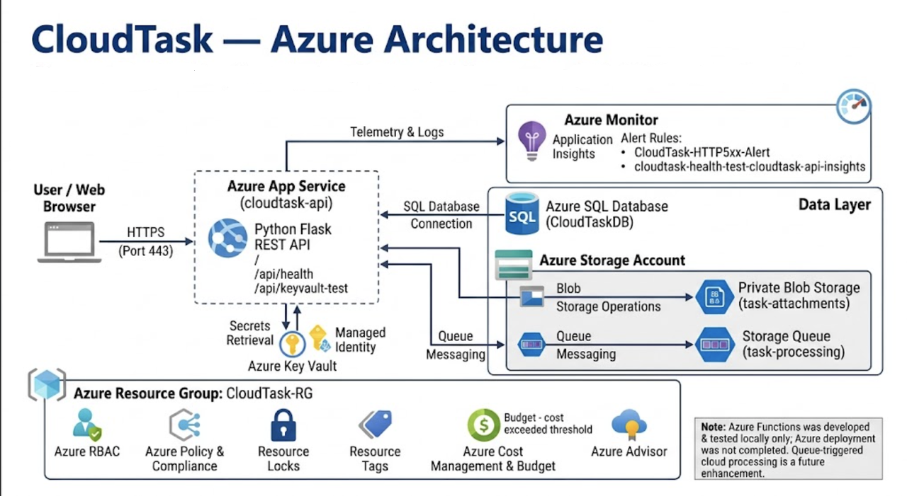

# CloudTask — Azure Cloud Architecture & Web API

A practical Azure cloud deployment demonstrating multi-tier application hosting, managed relational data, secrets retrieval via Managed Identity, asynchronous queue messaging, monitoring with alert rules, and resource governance.

---

## 1. Project Overview

CloudTask bridges backend software engineering and cloud operations. The project deploys a Python Flask REST API to **Azure App Service**, connects to **Azure SQL Database**, manages files and message queues via an **Azure Storage Account**, retrieves configuration secrets from **Azure Key Vault** using a **Managed Identity**, and enforces enterprise governance in the **CloudTask-RG** resource group.

---

## 2. Architecture & Request Flow

1. **Client Ingress:** Web clients communicate over HTTPS (Port 443).
2. **Compute Layer:** **Azure App Service (`cloudtask-api`)** runs the Python Flask REST API.
3. **Identity & Secrets:** App Service queries **Azure Key Vault** using system-assigned **Managed Identity** to retrieve connection secrets.
4. **Data Layer:**
   * **Azure SQL Database (`CloudTaskDB`):** Manages relational application state over a secure SQL connection.
   * **Azure Storage Account:**
     * **Private Blob Storage (`task-attachments`):** Stores file attachments via blob storage operations.
     * **Storage Queue (`task-processing`):** Decouples asynchronous operations via queue messaging.
5. **Monitoring & Operations:** Telemetry and execution logs stream directly to **Azure Monitor / Application Insights**.
6. **Background Worker Scope:** Background queue processing was developed and validated locally; Azure deployment of Azure Functions is planned for a future phase.

---

## 3. Technology Stack & Azure Services

| Service / Technology | Resource / Component Name | Role in Solution |
| :--- | :--- | :--- |
| **Compute** | Azure App Service (`cloudtask-api`) | Hosts the live Python Flask REST API runtime. |
| **Relational Database** | Azure SQL Database (`CloudTaskDB`) | Stores relational task records via managed SQL connection. |
| **Object Storage** | Private Blob Storage (`task-attachments`) | Stores task file attachments securely. |
| **Message Queue** | Storage Queue (`task-processing`) | Decouples task messaging workflows. |
| **Secrets Management** | Azure Key Vault | Centralizes connection strings and runtime credentials. |
| **Identity & Access** | Azure Managed Identity & Azure RBAC | Enforces zero-credential authentication and least-privilege roles. |
| **Monitoring** | Azure Monitor & Application Insights | Live telemetry tracking and active operational alerts. |
| **Governance** | Azure Policy, Resource Locks, Resource Tags | Enforces tag compliance and accidental deletion locks. |
| **Cost & Advisory** | Azure Cost Management, Budgets, Azure Advisor | Budget threshold alerting and operational recommendations. |

---

## 4. Application Endpoints

| Category | Method | Endpoint | Description | Verification Status |
| :--- | :--- | :--- | :--- | :--- |
| Health | `GET` | `/` | Confirms that the CloudTask API is running. | Verified |
| Health | `GET` | `/api/health` | Returns the API health status and application information. | Verified |
| Users | `GET` | `/api/users` | Retrieves all users from Azure SQL Database. | Verified |
| Users | `GET` | `/api/users/{user_id}` | Retrieves a specific user by ID. | Verified |
| Users | `POST` | `/api/users` | Creates a new user using the provided name and email. | Verified |
| Projects | `GET` | `/api/projects` | Retrieves all projects from Azure SQL Database. | Verified |
| Projects | `POST` | `/api/projects` | Creates a new project with a name and optional description. | Verified |
| Tasks | `GET` | `/api/tasks` | Retrieves all tasks and their details. | Verified |
| Tasks | `GET` | `/api/tasks/{task_id}` | Retrieves a specific task by ID. | Verified |
| Tasks | `POST` | `/api/tasks` | Creates a task associated with a project. | Verified |
| Tasks | `PUT` | `/api/tasks/{task_id}` | Updates a task's title, description, status, assignee, and due date. | Verified |
| Tasks | `DELETE` | `/api/tasks/{task_id}` | Deletes a task by ID. | Verified |
| Comments | `GET` | `/api/tasks/{task_id}/comments` | Retrieves comments associated with a specific task. | Verified |
| Comments | `POST` | `/api/tasks/{task_id}/comments` | Adds a comment to a task for a specified user. | Verified |
| Attachments & Azure Storage | `POST` | `/api/tasks/{task_id}/attachments` | Uploads a task attachment to Azure Blob Storage and sends a processing message to Azure Queue Storage. | Verified |
| Azure Key Vault | `GET` | `/api/keyvault-test` | Checks Key Vault secret access and returns the secret's length without exposing its value. | Verified |

---

## 5. Security, Monitoring & Governance

* **Zero-Secret Codebase:** App Service retrieves secrets via a system-assigned Managed Identity from Azure Key Vault, preventing credentials in version control[cite: 1].
* **Access Control:** Azure Role-Based Access Control (RBAC) scopes permissions strictly at the resource group level[cite: 1].
* **Resource Immutability:** A `CanNotDelete` Resource Lock on `CloudTask-RG` prevents accidental resource deletion during maintenance[cite: 1].
* **Resource Tagging & Policies:** Standardized tags (`Project: CloudTask`, `Environment: Dev`) are enforced across resources[cite: 1].
* **Operational Alert Rules:** Azure Monitor Application Insights tracks reliability through configured rules[cite: 1]:
  * `CloudTask-HTTP5xx-Alert` (triggers on HTTP 5xx server errors)[cite: 1]
  * `cloudtask-health-test-cloudtask-api-insights` (tracks health endpoint synthetic probe failures)[cite: 1]
* **Cost Governance:** Budget notifications configured (`Budget - cost exceeded threshold`) to track consumption against spending limits[cite: 1].

---

## 6. Verification Evidence
Artifacts and logs validating the live deployment are cataloged in screenshots/:

01-resource-group-overview.png — Deployed services inside CloudTask-RG showing tag definitions.

02-api-health-keyvault-response.png — Verified HTTP 200 responses for /api/health and /api/keyvault-test.

03-sql-database-connection.png — Active CloudTaskDB deployment and SQL query metrics.

04-storage-blob-queue.png — Created task-attachments blob container and task-processing queue.

05-alerts-insights.png — Configured alert rules (CloudTask-HTTP5xx-Alert and health test probes).

06-governance-budget.png — Resource locks, policy compliance checks, and budget threshold configuration.

